  

**Analista de infraestrutura de TI e desenvolvedor Python.** Cuido da TI de um grupo da Serra Gaúcha que reúne uma indústria de laticínios, um parque turístico e uma loja, onde desde outubro também faço a gestão da loja e da bilheteria. Pela AZ Sistemas, minha empresa, faço sistemas e automações para pequenas e médias empresas.\
Bento Gonçalves, RS · [sistemasaz.com.br](https://sistemasaz.com.br) · [LinkedIn](https://www.linkedin.com/in/allan-zeni) · [English below](#english)

### vault-vector

O [vault-vector](https://github.com/All-zen/vault-vector) é a memória que a IA usa comigo. Ele indexa as minhas notas markdown no meu próprio computador, sem mandar nada para fora, e expõe busca e escrita como servidor MCP para o Claude Code e o Claude Desktop. Hoje são 699 notas e 6.080 trechos num índice de 71 MB.

  

- Funde a busca vetorial (bge-m3 no Ollama) com a literal (SQLite FTS5) por Reciprocal Rank Fusion, então acha tanto a pergunta conceitual quanto o hostname, o IP ou o código de erro exato.
- Classifica cada resultado em confiança alta, média ou baixa, porque o score do RRF só mede a concordância entre os dois rankings. Na calibração, com 8 perguntas legítimas e 8 fora do assunto, nenhuma legítima caiu em baixa e nenhuma fora do assunto caiu em alta.
- Na faixa média, um modelo pequeno rodando só em CPU dá nota de 0 a 10 para cada trecho duvidoso. Isso levou 5 das 8 perguntas legítimas para confiança alta, a um custo de 0,3 a 1,7 s por trecho.
- Escreve pelo MCP com sete ferramentas (editar, acrescentar, criar, mover, apagar, listar e reindexar). Toda gravação guarda a versão anterior em `_historico/`, e mover uma nota reescreve os wikilinks que apontavam para ela.
- Lê o próprio índice e descreve seções, subpastas e convenções para o modelo, que assim navega um vault que nunca viu sem instrução escrita à mão.
- Usa SQLite e numpy no lugar de banco vetorial, recorta por título sem partir tabela nem bloco de código e reindexa só o que mudou. `vault-vector init` instala do zero, e `calibrar` refaz a medição das faixas no vault de cada um.

### Infraestrutura

Cuido de servidores, rede, Wi-Fi com 11 pontos de acesso UniFi, backup e monitoramento, sobre Proxmox com contêineres Linux, Windows Server com Active Directory e Sophos. No Zabbix são 102 hosts (servidores e contêineres, computadores, PDVs, câmeras, pontos de acesso, switches, links de internet e checagens externas), configurados pela API em Python; no Grafana, 7 dashboards com 125 painéis. Três diagnósticos que estão no vault:

- As quedas do Wi-Fi de visitantes vinham do pool DHCP: 241 endereços para cerca de 245 aparelhos por dia, com concessão de 24 h. Ampliei a faixa para 252 e reduzi a concessão para 4 h.
- A checagem do gateway só confirmava que o equipamento respondia ao ping e continuava verde com a internet parada. Agora ela testa TCP 443 e DNS.
- O canal de alertas registrou 261 envios que o provedor tinha recusado com HTTP 203, um código 2xx com a recusa no corpo da resposta. Hoje um alerta só conta como entregue com confirmação positiva.

### Sistemas

Pela AZ, desenvolvi e mantenho o sistema de gestão da indústria, em Python, Flask e PostgreSQL: mais de 20 módulos e mais de 150 migrações de banco em produção. O deploy roda por um runner próprio do GitHub Actions no Proxmox, com teste de fumaça e rollback automático, e um hook de pre-push roda os testes que cada mudança alcança (9.570 na suíte inteira). O sistema é privado. O [NotaFlow](https://github.com/All-zen/NotaFlow) é público, um projeto-demo de contas a pagar com dados fictícios que lê a fatura com OCR, confere com regras e IA local e lança no ERP.

A arquitetura e as decisões são minhas, o código é gerado por IA a partir da minha especificação, e eu reviso e respondo por ele em produção. Ainda não trabalhei com nuvem pública em produção nem com Kubernetes.

**Stack:** Proxmox VE · Proxmox Backup Server · Windows Server · Linux · Active Directory · Sophos · VLANs · VPN · UniFi · Zabbix e a API dele em Python · Grafana · Python · Flask · PostgreSQL · pytest · GitHub Actions · Docker · Ollama · MCP

### AZ Sistemas

Sistemas sob medida e automações para pequenas e médias empresas da Serra Gaúcha: [sistemasaz.com.br](https://sistemasaz.com.br)

---

### English

**IT infrastructure analyst and Python developer.** I look after IT for a group in southern Brazil that runs a dairy plant, a tourist park and a retail store, and since October I have also managed the store and the ticket office. Through AZ Sistemas, my own company, I build and maintain the dairy plant's management system.

[vault-vector](https://github.com/All-zen/vault-vector) is the memory the AI works with: a hybrid search over my markdown notes that runs entirely on my own computer and is exposed as an MCP server. It currently holds 699 notes and 6,080 passages in a 71 MB index.

- It merges bge-m3 vector similarity and SQLite FTS5 keyword search with Reciprocal Rank Fusion, so it finds a concept as well as an exact hostname, IP or error code.
- It labels every result high, medium or low confidence, because the RRF score only measures agreement between the two rankings. In calibration, with 8 legitimate questions and 8 off-topic ones, no legitimate question landed in low and no off-topic one landed in high.
- In the medium band, a small CPU-only model scores each doubtful passage from 0 to 10, which moved 5 of the 8 legitimate questions to high confidence at 0.3 to 1.7 s per passage.
- It writes through seven MCP tools; every write keeps the previous version in `_historico/`, and moving a note rewrites the wikilinks that pointed to it.
- It reads its own index and describes the vault's structure, so the model can navigate a vault it has never seen.

On the infrastructure side I monitor 102 hosts in Zabbix (servers and containers, computers, POS terminals, cameras, access points, switches, WAN links and external checks), configured through the API in Python, with 7 Grafana dashboards and 125 panels. I traced guest Wi-Fi outages to a DHCP pool with 241 addresses for about 245 devices a day, replaced a gateway check that stayed green with the internet down, and found an alert channel that logged 261 sends while the provider refused every one with HTTP 203.

The management system runs on Python, Flask and PostgreSQL, with more than 150 database migrations in production. Deploys go through a self-hosted GitHub Actions runner on Proxmox with a smoke test and automatic rollback, and a pre-push hook runs the tests each change reaches (9,570 in the full suite). The architecture and decisions are mine, the code is AI-generated under my specification, and I review it and am accountable for it in production. Not yet in my experience: public cloud in production and Kubernetes.

Bento Gonçalves, Brazil (UTC−3) · [LinkedIn](https://www.linkedin.com/in/allan-zeni) · [sistemasaz.com.br](https://sistemasaz.com.br)
