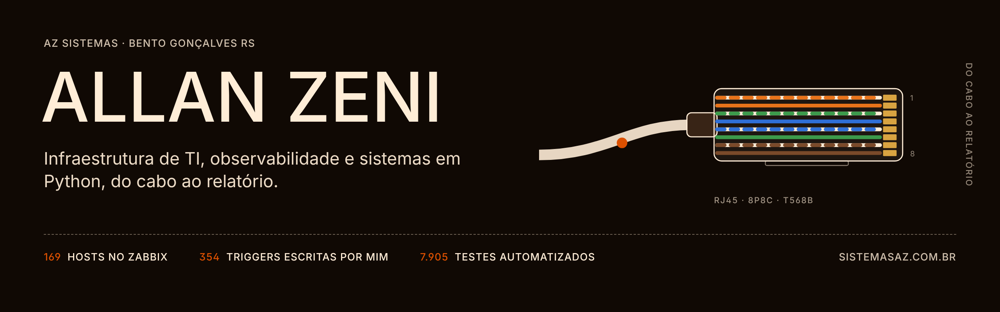

**Analista de Infraestrutura de TI e desenvolvedor Python.** Pela AZ Sistemas, minha empresa, faço sistemas e automações para pequenas e médias empresas.\
Bento Gonçalves, RS · [sistemasaz.com.br](https://sistemasaz.com.br) · [LinkedIn](https://www.linkedin.com/in/allan-zeni) · [English below](#english)

Sou o único profissional de TI de um grupo da Serra Gaúcha com indústria de laticínios, parque turístico e loja. Cuido de servidores, rede, Wi-Fi entre unidades, backup e monitoramento, e desenvolvi e mantenho o sistema de gestão da indústria.

| 169 | 354 | 122 | 7.905 |
|:---|:---|:---|:---|
| hosts no Zabbix | triggers escritas por mim | painéis no Grafana | testes automatizados no sistema de gestão |

### Três diagnósticos

- **A rede de visitantes caía e a culpa ia para o Wi-Fi.** O pool DHCP esgotava: 241 endereços para cerca de 245 aparelhos por dia, com concessão de 24 h. Ampliei a faixa e reduzi a concessão para 4 h.
- **Gateway verde, internet parada.** A checagem só confirmava que o equipamento respondia. Reescrevi para testar TCP 443 e DNS.
- **261 alertas "enviados" que ninguém recebeu.** O provedor recusava todos com código 2xx e a recusa no corpo da resposta. O script agora exige confirmação positiva de entrega.

### Projetos públicos

- [**vault-vector**](https://github.com/All-zen/vault-vector) · Busca semântica híbrida e local sobre notas markdown, exposta como servidor MCP. Ollama e SQLite, nada vai para a nuvem.
- [**NotaFlow**](https://github.com/All-zen/NotaFlow) · Automação de contas a pagar, projeto-demo com dados fictícios: lê a fatura com OCR, confere com regras e IA local e lança no ERP. Fila SQLite com máquina de estados, retry, idempotência e auditoria.

O sistema de gestão da indústria é privado: 22 módulos em Python, Flask e PostgreSQL, com testes que rodam antes de cada push e no GitHub Actions e protegem regras de segurança alimentar.

### Como trabalho com IA

A arquitetura e as decisões são minhas, o código é gerado por IA a partir da minha especificação, e eu reviso e respondo por ele em produção.

### Stack

- **Infraestrutura:** Proxmox VE · Proxmox Backup Server · Windows Server · Linux · Active Directory · Sophos · VLANs · VPN · UniFi
- **Observabilidade:** Zabbix (configurado pela API em Python) · Grafana
- **Desenvolvimento:** Python · Flask · PostgreSQL · pytest · GitHub Actions · Docker · Ollama · MCP

Ainda não trabalhei com nuvem pública em produção nem com Kubernetes.

### AZ Sistemas

Sistemas sob medida e automações para pequenas e médias empresas da Serra Gaúcha. Resposta em até 2 h em horário comercial, falando direto com quem desenvolve. → [sistemasaz.com.br](https://sistemasaz.com.br)

---

### English

**IT Infrastructure Analyst and Python developer.** I am the only IT professional for a group in southern Brazil with a dairy plant, a tourist park and a retail store: servers, network, Wi-Fi across sites, backup and monitoring. Through AZ Sistemas, my own company, I built and maintain the dairy plant's management system.

- **Guest Wi-Fi kept dropping, and Wi-Fi took the blame.** The DHCP pool was running out: 241 addresses for about 245 devices a day on 24-hour leases. I widened the range and cut leases to 4 hours.
- **Green gateway, no internet.** The check only confirmed the device answered. I rewrote it to test TCP 443 and DNS.
- **261 alerts logged as sent, none delivered.** The provider refused all of them with a 2xx status and the refusal in the body. The script now requires a positive delivery confirmation.

169 hosts and 354 triggers I wrote in Zabbix, 122 Grafana panels, 7,905 automated tests in the management system. The architecture and decisions are mine, the code is AI-generated under my specification, and I review it and am accountable for it in production. Not yet in my experience: public cloud in production and Kubernetes.

Bento Gonçalves, Brazil (UTC−3) · [LinkedIn](https://www.linkedin.com/in/allan-zeni) · [sistemasaz.com.br](https://sistemasaz.com.br)
